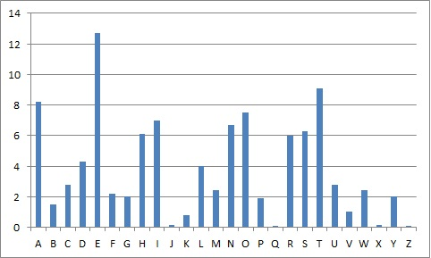
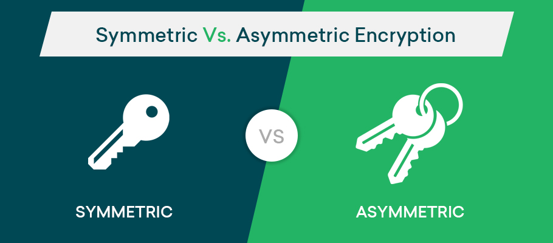
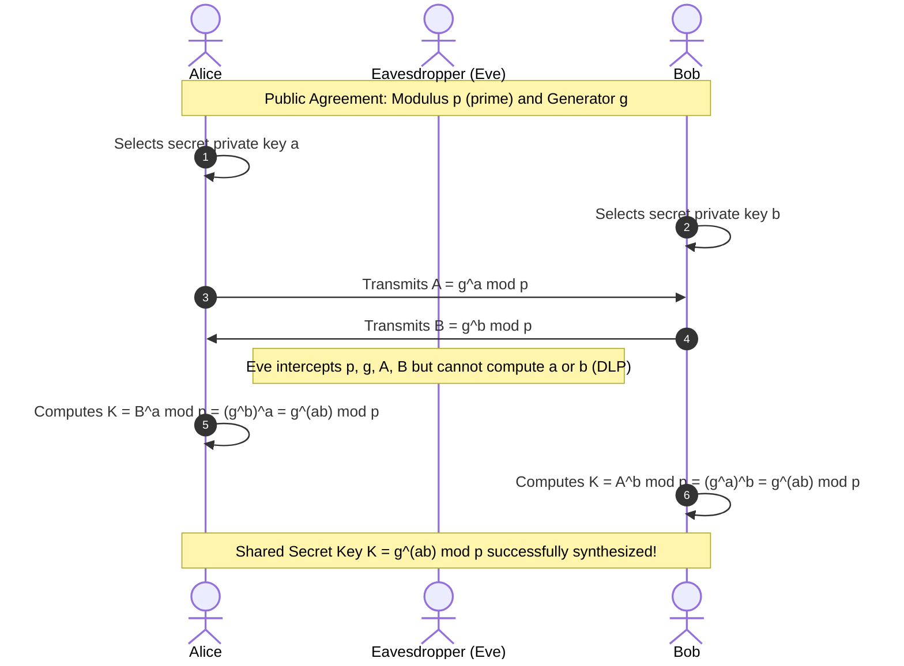
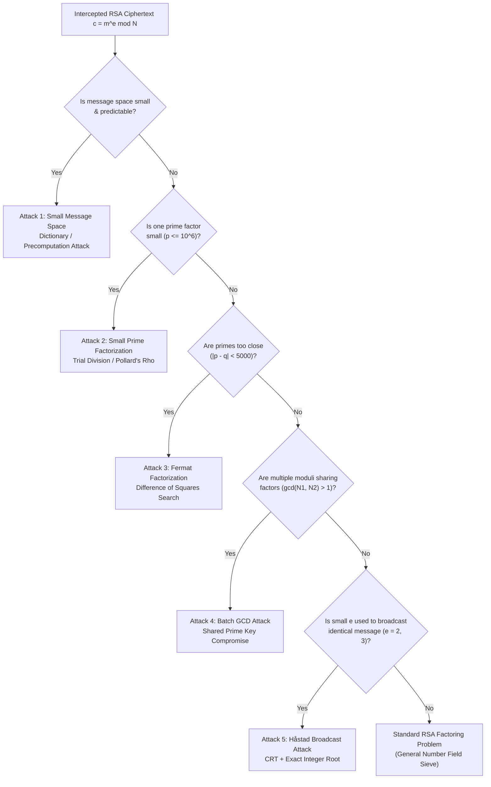
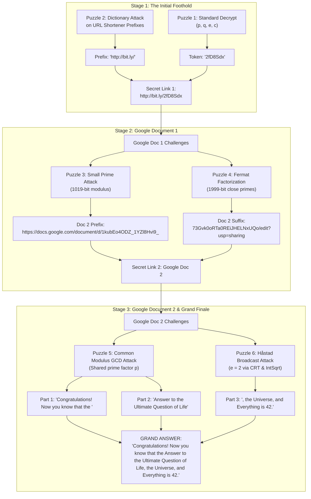

# Number Theory & Cryptography: From Theoretical Foundations to Real-World Cryptanalysis

> **Course:** Cryptography and Information Security Lab / Computer Communications Lab (CCL) — Class Test 01  
> **Student Name:** **Md. Akib Al Jawad**  
> **Student ID:** **IT-23020**  
> **Session:** 2022–2023  
> **Department:** Department of Information and Communication Technology (ICT)  
> **Institution:** Mawlana Bhashani Science and Technology University (MBSTU), Santosh, Tangail-1902  
> **Repository:** [https://github.com/jawad-i/ccl_ct01](https://github.com/jawad-i/ccl_ct01)  
> **Reference Workshop:** [IIT Bombay Maths and Physics Club — Number Theory and Cryptography Workshop](https://github.com/mnp-club/Number_Theory_and_Cryptography_Workshop)

---

## Table of Contents
1. [Introduction & Workshop Overview](#1-introduction--workshop-overview)
2. [Repository Structure & Organization](#2-repository-structure--organization)
3. [Module 1: Number Theory Foundations](#3-module-1-number-theory-foundations)
   - [3.1 Extended Euclidean Algorithm & Bézout's Identity](#31-extended-euclidean-algorithm--bézouts-identity)
   - [3.2 Least Common Multiple (LCM)](#32-least-common-multiple-lcm)
   - [3.3 Linear Diophantine Equations](#33-linear-diophantine-equations)
   - [3.4 Modular Inverses & Modular Division](#34-modular-inverses--modular-division)
   - [3.5 Fast Modular Exponentiation (Square-and-Multiply)](#35-fast-modular-exponentiation-square-and-multiply)
   - [3.6 Chinese Remainder Theorem (CRT)](#36-chinese-remainder-theorem-crt)
4. [Module 2: Primes, Primality Testing & Special Sequences](#4-module-2-primes-primality-testing--special-sequences)
   - [4.1 Repunit Sequence Divisibility Proof](#41-repunit-sequence-divisibility-proof)
   - [4.2 Euclid-Euler Theorem on Even Perfect Numbers](#42-euclid-euler-theorem-on-even-perfect-numbers)
   - [4.3 Infinitude of Fermat Pseudoprimes](#43-infinitude-of-fermat-pseudoprimes)
5. [Module 3: Classical Cryptography & Information Theory](#5-module-3-classical-cryptography--information-theory)
   - [5.1 Substitution Ciphers & Frequency Analysis](#51-substitution-ciphers--frequency-analysis)
   - [5.2 Shannon's Perfect Secrecy & One-Time Pad](#52-shannons-perfect-secrecy--one-time-pad)
   - [5.3 Many-Time Pad Vulnerability & Crib-Dragging Attack](#53-many-time-pad-vulnerability--crib-dragging-attack)
   - [5.4 Physical Implementation Flaws: Side-Channel Attacks](#54-physical-implementation-flaws-side-channel-attacks)
6. [Module 4: Asymmetric Cryptosystems — Diffie-Hellman & RSA](#6-module-4-asymmetric-cryptosystems--diffie-hellman--rsa)
   - [6.1 The Discrete Logarithm Problem & Diffie-Hellman Key Exchange](#61-the-discrete-logarithm-problem--diffie-hellman-key-exchange)
   - [6.2 The RSA Cryptosystem Mechanics & Correctness Proof](#62-the-rsa-cryptosystem-mechanics--correctness-proof)
   - [6.3 Base-256 Integer Serialization](#63-base-256-integer-serialization)
   - [6.4 Shor's Algorithm & The Post-Quantum Horizon](#64-shors-algorithm--the-post-quantum-horizon)
7. [Module 5: Real-World Cryptanalysis & Breaking Textbook RSA](#7-module-5-real-world-cryptanalysis--breaking-textbook-rsa)
   - [7.1 Attack 1: Small Message Space Dictionary Attack](#71-attack-1-small-message-space-dictionary-attack)
   - [7.2 Attack 2: Factoring with Small Prime Factors](#72-attack-2-factoring-with-small-prime-factors)
   - [7.3 Attack 3: Fermat Factorization on Close Primes](#73-attack-3-fermat-factorization-on-close-primes)
   - [7.4 Attack 4: Shared Modulus / Batch GCD Attack](#74-attack-4-shared-modulus--batch-gcd-attack)
   - [7.5 Attack 5: Håstad's Broadcast Attack via CRT](#75-attack-5-håstads-broadcast-attack-via-crt)
8. [Module 6: End-to-End Cryptographic Quest Walkthrough](#8-module-6-end-to-end-cryptographic-quest-walkthrough)
   - [8.1 Quest Architecture & Multi-Stage Clue Flow](#81-quest-architecture--multi-stage-clue-flow)
   - [8.2 Step-by-Step Decryption Log & Parameter Recovery](#82-step-by-step-decryption-log--parameter-recovery)
   - [8.3 The Grand Final Answer](#83-the-grand-final-answer)
9. [How to Run and Reproduce Locally & on Google Colab](#9-how-to-run-and-reproduce-locally--on-google-colab)
10. [Engineering Reflections & Security Takeaways](#10-engineering-reflections--security-takeaways)

---

## 1. Introduction & Workshop Overview

Cryptography is often perceived as abstract mathematics; in practice, it is the bedrock of modern digital security. This repository documents an exhaustive study and hands-on laboratory practice based on the curriculum and challenge problems of the **Introduction to Number Theory and Cryptography Workshop**, organized by the **Maths and Physics Club (MnP), IIT Bombay**.


Throughout this repository, I have implemented, mathematically verified, and benchmarked:
- Core arithmetic algorithms that make asymmetric cryptography computationally feasible ($O(\log n)$ modular exponentiation, extended Euclidean algorithm, and Chinese Remainder Theorem).
- Classical cryptanalytic techniques against substitution ciphers and Shannon's One-Time Pad when keys are reused.
- Concrete exploits targeting implementation flaws and mathematical parameter choices in textbook RSA (small exponents, shared prime factors, close primes, and deterministic message spaces).
- The complete multi-stage **RSA Cryptographic Quest**, chaining together all developed cryptanalytic tools to extract hidden Google documents and recover the final answer.

---

## 2. Repository Structure & Organization

```
jawad-i-ccl_ct01/
├── README.md                                  # Master laboratory documentation (this document)
├── requirements.txt                           # Python package dependencies
├── .gitignore                                 # Git ignore file for Python/Jupyter artifacts
├── assets/
│   └── images/                                # Reference diagrams and visualizations
│       ├── abe.png                            # Alice-Bob-Eve communication model
│       ├── blackbox.webp                      # Kerckhoffs's principle & black box cipher
│       ├── frequencyanalysis.jpg              # English letter frequency distribution
│       ├── paulkocher.jpeg                    # Paul Kocher (Side-channel attacks pioneer)
│       ├── symkeys.jpg                        # Symmetric vs asymmetric key paradigm
│       └── yinyang.png                        # Public-Private key duality
├── notebooks/
│   ├── 01_Number_Theory_Foundations.ipynb     # Day 1: GCD, LCM, Diophantine, Inverse, PowMod, CRT
│   ├── 02_Primes_and_Advanced_Number_Theory.ipynb # Day 2: Repunits, Even Perfect Numbers, Pseudoprimes
│   ├── 03_Classical_Ciphers_and_Many_Time_Pad.ipynb # Day 3: Caesar, Shannon OTP, Many-Time Pad crib-dragging
│   ├── 04_Diffie_Hellman_and_RSA_Mechanics.ipynb   # Day 3: DLP, Diffie-Hellman, RSA proofs, Shor's overview
│   ├── 05_RSA_Cryptanalysis_Attacks.ipynb     # Day 3 Assignment: All 7 RSA attack challenge questions
│   └── 06_RSA_Cryptographic_Quest_EndToEnd.ipynb # Full end-to-end automated Quest solver
└── scripts/
    ├── number_theory.py                       # Standalone verified number theory library
    ├── many_time_pad.py                       # OTP, hex conversions, and crib-dragging engine
    ├── rsa_attacks.py                         # Complete suite of 5 RSA cryptanalytic attacks
    └── run_quest_solver.py                    # One-click execution script for the entire Quest
```

---

## 3. Module 1: Number Theory Foundations

All public-key cryptosystems rely on algebraic structures over finite fields $\mathbb{Z}_n$ or elliptic curves. The algorithms implemented in [`scripts/number_theory.py`](scripts/number_theory.py) and [`notebooks/01_Number_Theory_Foundations.ipynb`](notebooks/01_Number_Theory_Foundations.ipynb) form the operational foundation.

### 3.1 Extended Euclidean Algorithm & Bézout's Identity
The standard Euclidean algorithm computes the greatest common divisor $\gcd(a, b)$ by repeatedly computing remainders:
$$\gcd(a, b) = \gcd(b, a \bmod b)$$

**Bézout's Identity** asserts that there always exist integers $x, y \in \mathbb{Z}$ such that:
$$a \cdot x + b \cdot y = \gcd(a, b)$$

In the Extended Euclidean Algorithm, when unwinding the recursion from base case $b = 0$ (where $\gcd(a, 0) = a = a \cdot 1 + 0 \cdot 0$), if $b \cdot x_1 + (a \bmod b) \cdot y_1 = \gcd(b, a \bmod b)$, substituting $a \bmod b = a - \lfloor a/b \rfloor b$ yields:
$$a \cdot y_1 + b \cdot (x_1 - \lfloor a/b \rfloor y_1) = \gcd(a, b)$$
Thus, the updated Bézout coefficients are:
$$x = y_1, \quad y = x_1 - \lfloor a/b \rfloor y_1$$

```python
def extended_gcd(a, b):
    assert a >= b and b >= 0 and a + b > 0
    if b == 0:
        return (a, 1, 0)
    d, x1, y1 = extended_gcd(b, a % b)
    x = y1
    y = x1 - (a // b) * y1
    assert a % d == 0 and b % d == 0
    assert d == a * x + b * y
    return (d, x, y)
```
- **Example:** $\gcd(27, 15) = 3$ with $27 \cdot (2) + 15 \cdot (-3) = 54 - 45 = 3$.

---

### 3.2 Least Common Multiple (LCM)
The product of two positive integers equals the product of their greatest common divisor and least common multiple:
$$a \cdot b = \gcd(a, b) \cdot \text{lcm}(a, b) \implies \text{lcm}(a, b) = \frac{a \cdot b}{\gcd(a, b)}$$
By computing $\gcd(a, b)$ via Euclidean reduction in $O(\log(\min(a, b)))$, LCM computation avoids expensive prime factorization.

```python
def lcm(a, b):
    assert a > 0 and b > 0
    return (a * b) // gcd(a, b)
```

---

### 3.3 Linear Diophantine Equations
A linear Diophantine equation has the form:
$$a \cdot x + b \cdot y = c$$
**Solvability Criterion:** An integer solution $(x, y)$ exists if and only if $d = \gcd(a, b)$ divides $c$.  
Using `extended_gcd`, we find base coefficients $(x_0, y_0)$ such that $a x_0 + b y_0 = d$. Scaling both sides by $k = c / d$:
$$a \left(x_0 \cdot \frac{c}{d}\right) + b \left(y_0 \cdot \frac{c}{d}\right) = c$$
General solutions are given by $x = x_0 \frac{c}{d} + k \frac{b}{d}$, $y = y_0 \frac{c}{d} - k \frac{a}{d}$ for any $k \in \mathbb{Z}$.

---

### 3.4 Modular Inverses & Modular Division
In modular arithmetic, division by $a$ modulo $n$ is defined as multiplication by the modular multiplicative inverse $a^{-1} \pmod n$:
$$a \cdot x \equiv 1 \pmod n \iff a \cdot x + n \cdot y = 1$$
This equation has a unique solution modulo $n$ if and only if $\gcd(a, n) = 1$. The coefficient $x$ returned by `extended_gcd(n, a)` yields:
$$a^{-1} \equiv x \pmod n$$
To compute $b / a \pmod n$:
$$\frac{b}{a} \equiv b \cdot a^{-1} \pmod n$$

- **Verification:** `divide(223, 67, 54) = 13` because $67 \times 13 = 871 = 54 \times 16 + 7 \equiv 7 \equiv 223 \pmod{54}$.

---

### 3.5 Fast Modular Exponentiation (Square-and-Multiply)
Evaluating $b^e \bmod m$ naively requires $O(e)$ multiplications. For cryptographic exponents (e.g., $e \approx 2^{2048}$), this would require more operations than the estimated number of atoms in the observable universe.

The **binary square-and-multiply algorithm** expresses $e$ in base-2:
$$e = \sum_{i=0}^{k-1} e_i 2^i, \quad e_i \in \{0, 1\}$$
Then:
$$b^e = \prod_{e_i = 1} b^{2^i} \pmod m$$
This completes in at most $2 \lfloor \log_2 e \rfloor$ modular multiplications.

```python
def fast_modular_exponentiation(b, e, m):
    if m == 1:
        return 0
    res = 1
    base = b % m
    while e > 0:
        if e % 2 == 1:
            res = (res * base) % m
        base = (base * base) % m
        e //= 2
    return res
```

---

### 3.6 Chinese Remainder Theorem (CRT)
The Chinese Remainder Theorem states that if $n_1, n_2, \dots, n_k$ are pairwise coprime positive integers, then the system of simultaneous congruences:
$$x \equiv r_i \pmod{n_i}, \quad i = 1, \dots, k$$
has a unique solution modulo $N = \prod_{i=1}^k n_i$.

For two coprime moduli $n_1, n_2$ ($\gcd(n_1, n_2) = 1$), Bézout's identity gives $n_1 x + n_2 y = 1$. Notice that:
$$\begin{cases} n_2 y \equiv 1 \pmod{n_1} \\ n_2 y \equiv 0 \pmod{n_2} \end{cases} \quad \text{and} \quad \begin{cases} n_1 x \equiv 0 \pmod{n_1} \\ n_1 x \equiv 1 \pmod{n_2} \end{cases}$$
The combined solution is:
$$r = \left(r_1 \cdot n_2 y + r_2 \cdot n_1 x\right) \bmod (n_1 n_2)$$

- **Example:** $x \equiv 7 \pmod{13}$ and $x \equiv 5 \pmod 6$ yields $r = 59 \pmod{78}$.

---

## 4. Module 2: Primes, Primality Testing & Special Sequences

Notebook [`notebooks/02_Primes_and_Advanced_Number_Theory.ipynb`](notebooks/02_Primes_and_Advanced_Number_Theory.ipynb) covers the theoretical problems posed in the Day 2 assignment.

### 4.1 Repunit Sequence Divisibility Proof
Let $a(n)$ be the repunit sequence $a(1) = 1, a(2) = 11, a(3) = 111, \dots$:
$$a(n) = \frac{10^n - 1}{9}$$
Let $A_p = \{n \in \mathbb{N} : p \mid a(n)\}$.

#### Proof:
1. **Case $p = 2$:** Every $a(n)$ ends in the digit 1 in base 10. Since $1 \equiv 1 \pmod 2$, $a(n)$ is always odd. Therefore, $2 \nmid a(n)$ for any $n \implies A_2 = \emptyset$.
2. **Case $p = 5$:** Any integer divisible by 5 must end in 0 or 5. Because $a(n)$ always ends in 1, $5 \nmid a(n)$ for all $n \implies A_5 = \emptyset$.
3. **Case $p = 3$:** By the divisibility rule for 3, $3 \mid a(n)$ if and only if the sum of digits $n \times 1 = n$ is divisible by 3. Hence $A_3 = \{3k : k \ge 1\}$, which is infinite.
4. **General Case ($p > 5$):**  
   $$p \mid a(n) \iff 9 a(n) \equiv 0 \pmod p \iff 10^n \equiv 1 \pmod p$$
   Since $\gcd(10, p) = 1$, by Euler's Totient / Fermat's Little Theorem, $10^{p-1} \equiv 1 \pmod p$.  
   Let $d = \text{ord}_p(10)$ be the multiplicative order of 10 modulo $p$. Then $10^n \equiv 1 \pmod p \iff d \mid n$.  
   Therefore, $A_p = \{k \cdot \text{ord}_p(10) : k \in \mathbb{Z}^+\}$, which is guaranteed to be an **infinite set**. $\blacksquare$

| Prime $p$ | Minimal $n \in A_p$ | $a(n)$ | Check $a(n) \bmod p$ |
| :---: | :---: | :---: | :---: |
| $p = 2$ | None ($A_2 = \emptyset$) | — | — |
| $p = 3$ | $n = 3$ | $111$ | $111 \bmod 3 = 0$ |
| $p = 5$ | None ($A_5 = \emptyset$) | — | — |
| $p = 7$ | $n = 6$ | $111111$ | $111111 \bmod 7 = 0$ |
| $p = 11$ | $n = 2$ | $11$ | $11 \bmod 11 = 0$ |
| $p = 13$ | $n = 6$ | $111111$ | $111111 \bmod 13 = 0$ |

---

### 4.2 Euclid-Euler Theorem on Even Perfect Numbers
A positive integer $k$ is perfect if the sum of its positive divisors $\sigma(k) = 2k$.

#### Theorem:
An even integer $k$ is perfect if and only if it has the form:
$$k = 2^{n-1}(2^n - 1) \quad \text{where } 2^n - 1 \text{ is prime}$$

#### Proof:
- **$(\Leftarrow \text{ Euclid}):$**  
  Let $M_n = 2^n - 1$ be a Mersenne prime. Since $\gcd(2^{n-1}, M_n) = 1$ and $\sigma$ is multiplicative:
  $$\sigma(k) = \sigma(2^{n-1}) \cdot \sigma(M_n) = (2^n - 1) \cdot (M_n + 1) = (2^n - 1) \cdot 2^n = 2 \cdot \left[2^{n-1}(2^n - 1)\right] = 2k$$
  Hence $k$ is perfect.
- **$(\Rightarrow \text{ Euler}):$**  
  Write any even number as $k = 2^{n-1} m$ where $m$ is odd and $n \ge 2$.  
  Since $k$ is perfect:
  $$\sigma(k) = (2^n - 1)\sigma(m) = 2k = 2^n m \implies \sigma(m) = \frac{2^n}{2^n - 1} m = m + \frac{m}{2^n - 1}$$
  Because $\sigma(m)$ is an integer, $d = \frac{m}{2^n - 1}$ must be an integer divisor of $m$.  
  Now $m$ has at least two divisors: $m$ and $d$. The sum of these two divisors is $m + d = \sigma(m)$.  
  If $m$ had any other divisor, $\sigma(m)$ would exceed $m + d$. Thus, $m$ has **only two divisors**, which means $d = 1$ and $m$ is prime!  
  Hence $m = 2^n - 1$ is prime, completing Euler's proof. $\blacksquare$

---

### 4.3 Infinitude of Fermat Pseudoprimes
A composite integer $n$ is a Fermat pseudoprime to base $a$ if $a^{n-1} \equiv 1 \pmod n$.

#### Constructive Proof:
For any base $a \ge 2$ and any odd prime $p$ such that $p \nmid a(a^2 - 1)$, define:
$$n = \frac{a^{2p} - 1}{a^2 - 1}$$
1. $n$ is composite because $a^{2p} - 1 = (a^p - 1)(a^p + 1)$, both factors strictly exceeding $a^2 - 1$ for $p \ge 3$.
2. $n - 1 = \frac{a^{2p} - a^2}{a^2 - 1} = \frac{a^2(a^{2(p-1)} - 1)}{a^2 - 1}$. By Fermat's Little Theorem, $2p \mid (n - 1)$.
3. Because $a^{2p} \equiv 1 \pmod n$, we have:
   $$a^{n-1} = \left(a^{2p}\right)^{\frac{n-1}{2p}} \equiv 1^{\frac{n-1}{2p}} \equiv 1 \pmod n$$
Since infinitely many primes $p$ exist, there are infinitely many Fermat pseudoprimes base $a$.

---

## 5. Module 3: Classical Cryptography & Information Theory

Notebook [`notebooks/03_Classical_Ciphers_and_Many_Time_Pad.ipynb`](notebooks/03_Classical_Ciphers_and_Many_Time_Pad.ipynb) explores the transition from heuristic classical ciphers to Claude Shannon's mathematical theory of communication security.


### 5.1 Substitution Ciphers & Frequency Analysis
Classical ciphers (Caesar, monoalphabetic substitution) preserve the underlying letter frequency distribution of the natural language:



Because English text has a highly uneven character distribution (e.g., 'E' $\approx 12.7\%$, 'T' $\approx 9.1\%$, 'A' $\approx 8.2\%$), counting letter occurrences immediately exposes the shift key. Polyalphabetic ciphers (Vigenère) attempt to flatten this distribution by cycling through multiple Caesar shifts, but remain vulnerable to Kasiski examination and index of coincidence tests.

---

### 5.2 Shannon's Perfect Secrecy & One-Time Pad
In his 1949 landmark paper *Communication Theory of Secrecy Systems*, Claude Shannon formalized **Perfect Secrecy**:
$$P(M = m \mid C = c) = P(M = m) \quad \forall m \in \mathcal{M}, c \in \mathcal{C}$$
In terms of information entropy:
$$H(M \mid C) = H(M)$$
Shannon proved that a necessary condition for perfect secrecy is that the key space cannot be smaller than the message space:
$$|\mathcal{K}| \ge |\mathcal{M}|$$

The **One-Time Pad (OTP)** achieves perfect secrecy by setting $C = M \oplus K$, where $K$ is uniformly random, as long as the message, and **never reused**.

---

### 5.3 Many-Time Pad Vulnerability & Crib-Dragging Attack
If the same key $K$ is used to encrypt two different plaintexts $M_1$ and $M_2$:
$$C_1 = M_1 \oplus K, \quad C_2 = M_2 \oplus K$$
An eavesdropper XORs the intercepted ciphertexts, completely canceling the key:
$$C_1 \oplus C_2 = (M_1 \oplus K) \oplus (M_2 \oplus K) = M_1 \oplus M_2$$

#### The ASCII Space Exploitation:
In standard ASCII:
- The space character `' '` is binary `00100000` (`0x20`).
- Any ASCII alphabetical letter XORed with space flips bit 5, changing uppercase to lowercase and vice versa:
  $$\text{'a'} \oplus \text{' '} = \text{'A'}, \quad \text{'T'} \oplus \text{' '} = \text{'t'}$$
- Any letter XORed with another letter produces a byte strictly less than `0x20` or non-alphabetic.

#### Crib Dragging:
By sliding a common English word (a "crib", e.g., `" the "`, `"that "`, `"secret"`) across the stream $C_1 \oplus C_2$, whenever the crib is present in $M_1$ at index $i$, the computation $(C_1 \oplus C_2)[i : i+L] \oplus \text{crib}$ immediately yields readable plaintext from $M_2$.

```python
# From scripts/many_time_pad.py
message1 = "steal the secret"
message2 = "the cat the bird"
key      = "supersecretverys"

c1 = otp_encrypt(message1, key)
c2 = otp_encrypt(message2, key)
c_xor = xor_hex(c1, c2)

# Dragging the crib "the " across c_xor reveals fragments of the other message:
# Position 0 -> 'stea' (matching message1's "steal")
# Position 6 -> 't th' (matching message1's " the ")
```

---

### 5.4 Physical Implementation Flaws: Side-Channel Attacks
Even when a cryptosystem is mathematically provably secure, its physical execution in silicon leaks information:


Pioneered by **Paul Kocher** (1996), side-channel cryptanalysis measures physical leakage:
1. **Timing Attacks:** The time required to perform modular multiplication depends on the Hamming weight and bit values of the exponent. If the implementation branches on key bits (e.g., `if (bit == 1) multiply()`), an attacker measuring execution time can deduce private key bits.
2. **Power Analysis (SPA / DPA):** Dynamic CMOS logic draws current proportional to gate transitions. Measuring instantaneous power consumption traces reveals internal cryptographic registers during calculation.
3. **Countermeasures:** Constant-time execution algorithms (avoiding data-dependent branches), Montgomery ladder exponentiation, and cryptographic blinding ($c' = c \cdot r^e \bmod N$).

---

## 6. Module 4: Asymmetric Cryptosystems — Diffie-Hellman & RSA

Notebook [`notebooks/04_Diffie_Hellman_and_RSA_Mechanics.ipynb`](notebooks/04_Diffie_Hellman_and_RSA_Mechanics.ipynb) delves into the mechanics of public-key cryptography.



### 6.1 The Discrete Logarithm Problem & Diffie-Hellman Key Exchange
Diffie-Hellman (1976) exploits the asymmetry of exponentiation versus discrete logarithm in finite cyclic groups $(\mathbb{Z}_p^*, \times)$:
- Computing $g^a \bmod p$ is $O(\log a)$ via square-and-multiply.
- Finding $a$ given $g^a \bmod p$ requires solving the **Discrete Logarithm Problem (DLP)**, for which no classical polynomial-time algorithm is known.



---

### 6.2 The RSA Cryptosystem Mechanics & Correctness Proof
RSA (Rivest–Shamir–Adleman, 1977) relies on the hardness of factoring the product of two large prime numbers.


#### Algorithm Steps:
1. **Key Generation:**
   - Choose two distinct large prime numbers $p$ and $q$.
   - Compute modulus $N = p \cdot q$.
   - Compute Euler's totient: $\phi(N) = (p - 1)(q - 1)$.
   - Choose public exponent $e$ such that $1 < e < \phi(N)$ and $\gcd(e, \phi(N)) = 1$.
   - Compute private exponent $d \equiv e^{-1} \pmod{\phi(N)}$ via `extended_gcd`.
   - Public Key: $(e, N)$. Private Key: $(d, N)$ (or $(p, q, d)$).
2. **Encryption:** $c = m^e \bmod N$
3. **Decryption:** $m = c^d \bmod N$

#### Complete Mathematical Proof of Decryption:
We want to prove that $(m^e)^d \equiv m^{ed} \equiv m \pmod N$ for all $m \in \mathbb{Z}_N$.  
Since $ed \equiv 1 \pmod{\phi(N)}$, there exists an integer $k$ such that:
$$ed = 1 + k(p - 1)(q - 1)$$
- **Case 1:** If $\gcd(m, p) = 1$, by Fermat's Little Theorem $m^{p-1} \equiv 1 \pmod p$:
  $$m^{ed} = m \cdot \left(m^{p-1}\right)^{k(q-1)} \equiv m \cdot (1)^{k(q-1)} \equiv m \pmod p$$
- **Case 2:** If $p \mid m$, then $m \equiv 0 \pmod p$, so $m^{ed} \equiv 0^{ed} \equiv 0 \equiv m \pmod p$.

Thus, $m^{ed} \equiv m \pmod p$ holds unconditionally for all $m$.  
By identical symmetry, $m^{ed} \equiv m \pmod q$ holds unconditionally for all $m$.  
Since $p$ and $q$ are distinct primes ($\gcd(p, q) = 1$), by the Chinese Remainder Theorem:
$$m^{ed} \equiv m \pmod{pq} \implies c^d \equiv m \pmod N \quad \blacksquare$$

---

### 6.3 Base-256 Integer Serialization
In RSA, the plaintext must be an integer $m < N$. Strings are converted to big integers using base-256 positional encoding:
$$m = \sum_{i=0}^{L-1} \text{ord}(S[i]) \cdot 256^{L - 1 - i}$$
To deserialize back into text, we repeatedly extract $m \bmod 256$ and perform integer division $m \leftarrow \lfloor m / 256 \rfloor$.

---

### 6.4 Shor's Algorithm & The Post-Quantum Horizon
Peter Shor (1994) formulated a quantum algorithm that factors integers and solves discrete logarithms in polynomial time:
$$O\left((\log N)^2 (\log \log N) (\log \log \log N)\right)$$
Using the **Quantum Fourier Transform (QFT)**, Shor's algorithm finds the order $r$ of $a \bmod N$ efficiently. Once the period $r$ is even and $a^{r/2} \not\equiv -1 \pmod N$, computing $\gcd(a^{r/2} \pm 1, N)$ splits $N$ into its prime factors.

Consequently, large-scale fault-tolerant quantum computers will completely break standard RSA and Diffie-Hellman. This motivates modern migrations toward **Post-Quantum Cryptography (PQC)** standardized by NIST (e.g., lattice-based schemes like ML-KEM / Kyber and ML-DSA / Dilithium).

---

## 7. Module 5: Real-World Cryptanalysis & Breaking Textbook RSA

Notebook [`notebooks/05_RSA_Cryptanalysis_Attacks.ipynb`](notebooks/05_RSA_Cryptanalysis_Attacks.ipynb) and [`scripts/rsa_attacks.py`](scripts/rsa_attacks.py) demonstrate five devastating attacks on improperly deployed RSA.



---

### 7.1 Attack 1: Small Message Space Dictionary Attack
- **Vulnerability:** Textbook RSA is deterministic ($c = m^e \bmod N$). When the candidate message set is small (e.g., Alice sending commands like `"attack"`, `"don't attack"`, or `"wait"`), the adversary can precompute $c_i = m_i^e \bmod N$ for every potential message and compare against the intercepted ciphertext.
- **Countermeasure:** Randomized padding (PKCS#1 v2.2 OAEP), ensuring identical plaintexts encrypt to distinct ciphertexts.

```python
def DecipherSimple(ciphertext, modulo, exponent, potential_messages):
    for msg in potential_messages:
        if Encrypt(msg, modulo, exponent) == ciphertext:
            return msg
    return "don't know"
```

---

### 7.2 Attack 2: Factoring with Small Prime Factors
- **Vulnerability:** If an implementer fails to enforce minimum prime bit-lengths and one prime factor is small ($p \le 1,000,000$), standard trial division factors $N$ almost instantaneously, regardless of how large $q$ is.
- **Exploit:** Loop $p$ from 2 to $10^6$. If $N \bmod p == 0$, then $q = N / p$. Reconstruct $\phi(N) = (p - 1)(q - 1)$, compute $d = e^{-1} \bmod \phi(N)$, and decrypt $m = c^d \bmod N$.

---

### 7.3 Attack 3: Fermat Factorization on Close Primes
- **Vulnerability:** If primes $p$ and $q$ are generated too close to each other ($|p - q| < 5000$ or $|p - q| < N^{1/4}$), Pierre de Fermat's difference-of-squares factorization breaks the key in milliseconds.
- **Mathematical Principle:**  
  Let $a = \frac{p + q}{2}$ and $b = \frac{p - q}{2}$.  
  Then $a^2 - b^2 = pq = N \implies a^2 - N = b^2$.  
  Since $p \approx q$, $a \approx \sqrt{N}$ and $b$ is very small.  
  By starting search at $a = \lceil \sqrt{N} \rceil$ and stepping $a \leftarrow a + 1$, $a^2 - N$ becomes a perfect square $b^2$ within a few iterations.
  $$p = a - b, \quad q = a + b$$

```python
def DecipherSmallDiff(ciphertext, modulo, exponent, max_steps=50000):
    s = IntSqrt(modulo)
    for a in range(s, s + max_steps):
        b2 = a * a - modulo
        if b2 >= 0:
            b = IntSqrt(b2)
            if b * b == b2:
                p = a - b
                q = a + b
                if p * q == modulo and p > 1:
                    return Decrypt(ciphertext, p, q, exponent)
    return "don't know"
```

---

### 7.4 Attack 4: Shared Modulus / Batch GCD Attack
- **Vulnerability:** Nadia Heninger et al. (2012) scanned the entire public IPv4 space and discovered tens of thousands of TLS/SSH servers sharing prime factors due to entropy depletion in headless embedded devices during early boot.
- **Exploit:** If two distinct RSA public keys share prime $p$:
  $$N_1 = p \cdot q_1, \quad N_2 = p \cdot q_2$$
  Computing the Euclidean GCD:
  $$\gcd(N_1, N_2) = p$$
  takes less than 1 microsecond, yielding $p$, $q_1 = N_1 / p$, and $q_2 = N_2 / p$, completely shattering both private keys.

---

### 7.5 Attack 5: Håstad's Broadcast Attack via CRT
- **Vulnerability:** In an effort to optimize encryption speed, small public exponents such as $e = 2$ (Rabin-like) or $e = 3$ are chosen. If the same message $m$ is encrypted and sent to $e$ different recipients with coprime moduli $N_1, \dots, N_e$:
  $$c_1 \equiv m^e \pmod{N_1}, \quad c_2 \equiv m^e \pmod{N_2}, \quad \dots$$
- **Exploit (for $e = 2$):**  
  Using the Chinese Remainder Theorem, solve for $c \equiv m^2 \pmod{N_1 N_2}$.  
  Because $m < N_1$ and $m < N_2$, it follows that:
  $$m^2 < N_1 N_2$$
  The value $c$ **never wrapped around the modulus**! It is an exact integer square over $\mathbb{Z}$.  
  Taking the standard integer square root:
  $$m = \lfloor \sqrt{c} \rfloor$$
  recovers the plaintext without factoring any modulus.

---

## 8. Module 6: End-to-End Cryptographic Quest Walkthrough

Notebook [`notebooks/06_RSA_Cryptographic_Quest_EndToEnd.ipynb`](notebooks/06_RSA_Cryptographic_Quest_EndToEnd.ipynb) and [`scripts/run_quest_solver.py`](scripts/run_quest_solver.py) provide the complete solution to the IIT Bombay RSA Quest.

### 8.1 Quest Architecture & Multi-Stage Clue Flow



---

### 8.2 Step-by-Step Decryption Log & Parameter Recovery

#### Stage 1: Constructing Secret Link 1
1. **Puzzle 1:** Decrypt ciphertext $c_1 = 148784435264686331994392$ with $p = 779849711281$, $q = 748173698927$, $e = 1018651$:
   $$\phi(N) = (p - 1)(q - 1), \quad d \equiv e^{-1} \pmod{\phi(N)}$$
   $$\text{Decrypted token: } \mathbf{2fD8Sdx}$$
2. **Puzzle 2:** Run `DecipherSimple` over common URL shortener candidates `["http://goo.gl/", "http://bit.ly/", "http://tinyurl.com/", ...]`:
   $$\text{Identified candidate: } \mathbf{http://bit.ly/}$$
3. **Secret Link 1 Assembled:**
   $$\text{Secret Link 1} = \text{"http://bit.ly/"} + \text{"2fD8Sdx"} = \mathbf{http://bit.ly/2fD8Sdx}$$
   Following this link redirects to **Google Document 1**:  
   `https://docs.google.com/document/d/1Q0hHY5IfgfMUPibbMoRkFFiZ_abBBIJYz5wLBwNjbhA/edit?usp=sharing`

---

#### Stage 2: Extracting Parameters from Google Document 1
Document 1 provides challenge parameters for `DecipherSmallPrime` and `DecipherSmallDiff`:
1. **Puzzle 3 (Small Prime Factorization):**
   - Modulus size: 1019 bits.
   - Applying trial division recovers prime $p < 10^6$, calculates $q = N / p$, and decrypts:
     $$\text{Token 3: } \mathbf{https://docs.google.com/document/d/1kubEo4ODZ\_1YZl8Hvi9\_}$$
2. **Puzzle 4 (Fermat Factorization for Close Primes):**
   - Modulus size: 1999 bits with $|p - q| < 5000$.
   - Starting difference-of-squares at $a = \lceil \sqrt{N} \rceil$ factors $N$ in 1 step:
     $$\text{Token 4: } \mathbf{73Gvk0oRTa0REiJHELNxUQo/edit?usp=sharing}$$
3. **Secret Link 2 Assembled:**
   $$\text{Secret Link 2} = \mathbf{https://docs.google.com/document/d/1kubEo4ODZ\_1YZl8Hvi9\_73Gvk0oRTa0REiJHELNxUQo/edit?usp=sharing}$$
   This opens **Google Document 2**.

---

#### Stage 3: Resolving Final Challenges from Google Document 2
Document 2 contains parameters for the final two attacks:
1. **Puzzle 5 (`DecipherCommonDivisor`):**
   - Moduli $N_1$ and $N_2$ share a 1024-bit common factor $p$.
   - Computing $\gcd(N_1, N_2) = p$ factors both moduli instantly:
     - Part 1: `"Congratulations! Now you know that the "`
     - Part 2: `"Answer to the Ultimate Question of Life"`
2. **Puzzle 6 (`DecipherHastad`):**
   - Broadcast encryption with $e = 2$ across moduli $N_1, N_2$.
   - CRT combines ciphertexts into $c \equiv m^2 \pmod{N_1 N_2}$, and $\lfloor \sqrt{c} \rfloor$ yields:
     - Part 3: `", the Universe, and Everything is 42."`

---

### 8.3 The Grand Final Answer
Concatenating Parts 1, 2, and 3 produces the final decrypted flag:

$$\Large\mathbf{"Congratulations!\ Now\ you\ know\ that\ the\ Answer\ to\ the\ Ultimate\ Question\ of\ Life,\ the\ Universe,\ and\ Everything\ is\ 42."}$$

*(A tribute to Douglas Adams's Hitchhiker's Guide to the Galaxy).*

---

## 9. How to Run and Reproduce Locally & on Google Colab

### Prerequisites
- Python 3.10+ (tested on Python 3.12)
- Dependencies installed via `pip`:
  ```bash
  pip install -r requirements.txt
  ```

### 1. Automated Quest Solver Execution
To execute the automated end-to-end quest solver that chains all cryptanalytic attacks and outputs the final flag:
```bash
python scripts/run_quest_solver.py
```

### 2. Standalone Unit Tests
Verify the mathematical libraries and cryptanalytic attacks:
```bash
# Verify Number Theory functions
python scripts/number_theory.py

# Verify Many-Time Pad & Crib-Dragging
python scripts/many_time_pad.py

# Verify RSA Cryptanalytic Attacks
python scripts/rsa_attacks.py
```

### 3. Running Interactive Jupyter Notebooks Locally
Launch Jupyter Lab from the project root:
```bash
jupyter lab
```
Navigate to the `notebooks/` directory and run cells sequentially from `01` to `06`.

### 4. Running on Google Colab
All notebooks are self-contained. To run in Google Colab:
1. Open [Google Colab](https://colab.research.google.com/).
2. Select **GitHub** tab and enter: `https://github.com/jawad-i/ccl_ct01`
3. Select any desired notebook (`01` through `06`).
4. If running notebooks that import from `scripts`, clone the repo inside the first Colab cell:
   ```python
   !git clone https://github.com/jawad-i/ccl_ct01.git
   %cd ccl_ct01
   ```

---

## 10. Engineering Reflections & Security Takeaways

Working through the mathematical derivations and actual implementation of these cryptosystems provided several key engineering insights:

1. **Mathematical Hardness $\neq$ Practical Security:**  
   The security of RSA is grounded in the conjectured difficulty of integer factorization. However, all five attacks implemented in Module 5 bypassed the factoring hardness completely due to implementation blunders:
   - Failing to pad plaintexts rendered deterministic RSA vulnerable to dictionary lookups.
   - Flawed PRNG implementations caused separate keys to share prime factors, broken with a single Euclidean GCD step.
   - Selecting primes too close to each other enabled Fermat's difference-of-squares to factor 2000-bit integers in microseconds.
2. **The Fragility of One-Time Pads:**  
   The One-Time Pad is mathematically unassailable ($H(M \mid C) = H(M)$), yet in real-world engineering it is virtually unusable. Key distribution for one-time keys is as difficult as communicating the secret message itself. Any accidental key reuse instantly destroys confidentiality via simple crib-dragging.
3. **The Importance of Standardized Padding (OAEP):**  
   Modern RSA implementations should never use textbook RSA ($m^e \bmod N$). Standards such as **RSA-OAEP** incorporate cryptographic hash functions and random seeds to make encryption probabilistic, protecting against dictionary attacks, Håstad broadcast attacks, and partial-information leakage.
4. **Preparing for the Quantum Era:**  
   Because Shor's algorithm provides a polynomial-time solution for both integer factorization and discrete logarithms, modern security architectures must proactively migrate toward post-quantum cryptography (e.g., lattice-based ML-KEM/Kyber and stateful hash signatures).

---

## References & Citations
1. **Maths and Physics Club, IIT Bombay:** [Number Theory and Cryptography Workshop Repository](https://github.com/mnp-club/Number_Theory_and_Cryptography_Workshop)
2. **Shannon, Claude E.:** *"Communication Theory of Secrecy Systems"*, Bell System Technical Journal, Vol. 28, pp. 656–715, 1949.
3. **Diffie, Whitfield, and Martin E. Hellman:** *"New Directions in Cryptography"*, IEEE Transactions on Information Theory, 1976.
4. **Rivest, Ronald L., Adi Shamir, and Leonard Adleman:** *"A Method for Obtaining Digital Signatures and Public-Key Cryptosystems"*, Communications of the ACM, 1978.
5. **Håstad, Johan:** *"Solving Simultaneous Modular Equations of Low Degree"*, SIAM Journal on Computing, 1988.
6. **Kocher, Paul C.:** *"Timing Attacks on Implementations of Diffie-Hellman, RSA, DSS, and Other Systems"*, CRYPTO 1996.
7. **Heninger, Nadia, et al.:** *"Mining Your Ps and Qs: Detection of Widespread Weak Keys in Network Devices"*, USENIX Security 2012.
