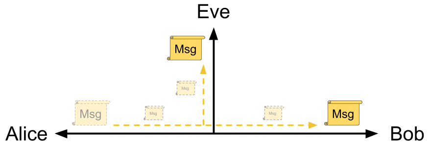
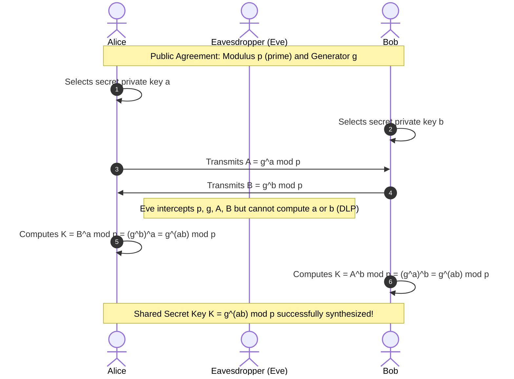
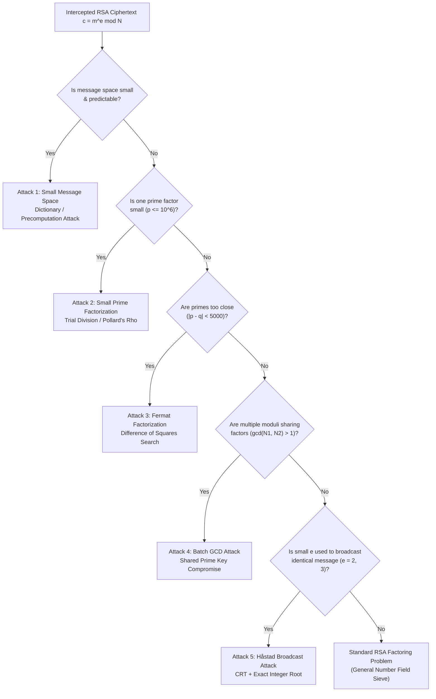

 # Number Theory & Cryptography: From Basic Concepts to Practical Cryptanalysis

> **Course:** Cryptography and Cyber Law (CCL) — Class Test 01  
> **Student Name:** **Md. Akib Al Jawad**  
> **Student ID:** **IT-23020**  
> **Session:** 2022–2023  
> **Department:** Department of Information and Communication Technology (ICT)  
> **Institution:** Mawlana Bhashani Science and Technology University (MBSTU), Santosh, Tangail-1902  
> **Repository:** [https://github.com/jawad-i/ccl_ct01](https://github.com/jawad-i/ccl_ct01)  
> **Reference Workshop:**(https://github.com/mnp-club/Number_Theory_and_Cryptography_Workshop)

---
 
---

## 1. Introduction & Workshop Overview

Cryptography is an important part of modern digital security. It uses mathematical concepts to protect information and make communication more secure.

In this repository, I have worked through the topics and challenge problems from the **Introduction to Number Theory and Cryptography Workshop**, organized by the **Maths and Physics Club (MnP), IIT Bombay**.



During this work, I studied and implemented several topics, including:

- Number theory algorithms such as modular exponentiation, the Extended Euclidean Algorithm, and the Chinese Remainder Theorem.
- Classical cryptography techniques, including substitution ciphers and One-Time Pad encryption.
- Different attacks on RSA caused by weak parameters or implementation mistakes, such as small exponents, shared prime factors, and closely generated primes.
- The complete multi-stage **RSA Cryptographic Quest**, where I used different cryptographic techniques to solve the challenges, find hidden Google documents, and recover the final answer.

---
                
## 3. Module 1: Number Theory Foundations

Number theory is closely related to public-key cryptography. Many cryptographic algorithms use mathematical operations involving integers, modular arithmetic, and prime numbers.

In this module, I worked with the algorithms available in [`scripts/number_theory.py`](scripts/number_theory.py) and practiced them in [`notebooks/01_Number_Theory_Foundations.ipynb`](notebooks/01_Number_Theory_Foundations.ipynb).

### 3.1 Extended Euclidean Algorithm & Bézout's Identity

The Euclidean Algorithm is used to find the greatest common divisor (GCD) of two integers. It repeatedly divides one number by another and continues with the remainder.

The main formula is:

$$\gcd(a, b) = \gcd(b, a \bmod b)$$

**Bézout's Identity** tells us that there are always integers $x$ and $y$ such that:

$$a \cdot x + b \cdot y = \gcd(a, b)$$

The Extended Euclidean Algorithm finds these two values along with the GCD.

When the recursion reaches the base case $b = 0$, we know that:

$$\gcd(a, 0) = a = a \cdot 1 + 0 \cdot 0$$

While returning from recursion, suppose:

$$b \cdot x_1 + (a \bmod b) \cdot y_1 = \gcd(b, a \bmod b)$$

Using:

$$a \bmod b = a - \lfloor a/b \rfloor b$$

we get:

$$a \cdot y_1 + b \cdot (x_1 - \lfloor a/b \rfloor y_1) = \gcd(a, b)$$

Therefore, the updated Bézout coefficients are:

$$x = y_1, \quad y = x_1 - \lfloor a/b \rfloor y_1$$

**Python Implementation:**

```python
def extended_gcd(a, b):
    assert a >= b and b >= 0 and a + b > 0
    if b == 0:
        return (a, 1, 0)
    d, x1, y1 = extended_gcd(b, a % b)
    x = y1
    y = x1 - (a // b) * y1
    assert a % d == 0 and b % d == 0
    assert d == a * x + b * y
    return (d, x, y)
```

- **Example:** $\gcd(27, 15) = 3$

  We can also write:

  $$27 \cdot (2) + 15 \cdot (-3) = 54 - 45 = 3$$

---

### 3.2 Least Common Multiple (LCM)

The Least Common Multiple (LCM) is the smallest positive integer that is divisible by both given numbers.

There is a useful relationship between GCD and LCM:

$$a \cdot b = \gcd(a, b) \cdot \text{lcm}(a, b)$$

From this, we get:

$$\text{lcm}(a, b) = \frac{a \cdot b}{\gcd(a, b)}$$

We can first calculate the GCD using the Euclidean Algorithm and then use it to find the LCM. This takes $O(\log(\min(a, b)))$ time and avoids the need for prime factorization.

**Python Implementation:**

```python
def lcm(a, b):
    assert a > 0 and b > 0
    return (a * b) // gcd(a, b)
```

---

### 3.3 Linear Diophantine Equations

A Linear Diophantine Equation is an equation of the form:

$$a \cdot x + b \cdot y = c$$

Here, we are looking for integer values of $x$ and $y$ that satisfy the equation.

**Solvability Criterion:**

An integer solution exists if and only if:

$$d = \gcd(a, b)$$

divides $c$.

Using `extended_gcd`, we can find initial coefficients $(x_0, y_0)$ such that:

$$a x_0 + b y_0 = d$$

We then multiply both sides by $k = c/d$:

$$a \left(x_0 \cdot \frac{c}{d}\right) + b \left(y_0 \cdot \frac{c}{d}\right) = c$$

The general solutions are:

$$x = x_0 \frac{c}{d} + k \frac{b}{d}$$

$$y = y_0 \frac{c}{d} - k \frac{a}{d}$$

where $k \in \mathbb{Z}$.

---

### 3.4 Modular Inverses & Modular Division

In modular arithmetic, division is performed using a modular multiplicative inverse.

The modular inverse of $a$ modulo $n$ is a number $x$ that satisfies:

$$a \cdot x \equiv 1 \pmod n$$

This can also be written as:

$$a \cdot x + n \cdot y = 1$$

A modular inverse exists if and only if:

$$\gcd(a, n) = 1$$

The coefficient $x$ returned by `extended_gcd(n, a)` gives:

$$a^{-1} \equiv x \pmod n$$

To calculate $b/a$ modulo $n$, we use:

$$\frac{b}{a} \equiv b \cdot a^{-1} \pmod n$$

- **Verification:** `divide(223, 67, 54) = 13`

  Because:

  $$67 \times 13 = 871 = 54 \times 16 + 7$$

  Therefore:

  $$871 \equiv 7 \pmod{54}$$

  and:

  $$223 \equiv 7 \pmod{54}$$

---

### 3.5 Fast Modular Exponentiation (Square-and-Multiply)

Calculating $b^e \bmod m$ directly can require a huge number of multiplications. This becomes a serious problem when working with large cryptographic exponents, such as $e \approx 2^{2048}$.

Fast Modular Exponentiation solves this problem by using the binary representation of the exponent.

The exponent can be written as:

$$e = \sum_{i=0}^{k-1} e_i 2^i, \quad e_i \in \{0, 1\}$$

Then:

$$b^e = \prod_{e_i = 1} b^{2^i} \pmod m$$

Instead of performing $e$ multiplications, the Square-and-Multiply method completes the calculation using at most $2\lfloor \log_2 e \rfloor$ modular multiplications.

**Python Implementation:**

```python
def fast_modular_exponentiation(b, e, m):
    if m == 1:
        return 0
    res = 1
    base = b % m
    while e > 0:
        if e % 2 == 1:
            res = (res * base) % m
        base = (base * base) % m
        e //= 2
    return res
```

---

### 3.6 Chinese Remainder Theorem (CRT)

The Chinese Remainder Theorem is used to solve a system of modular equations.

If $n_1, n_2, \dots, n_k$ are pairwise coprime positive integers, then the following system:

$$x \equiv r_i \pmod{n_i}, \quad i = 1, \dots, k$$

has a unique solution modulo:

$$N = \prod_{i=1}^k n_i$$

For two coprime moduli $n_1$ and $n_2$, Bézout's Identity gives:

$$n_1 x + n_2 y = 1$$

From this, we can see that:

$$
\begin{cases}
n_2 y \equiv 1 \pmod{n_1} \\
n_2 y \equiv 0 \pmod{n_2}
\end{cases}
\quad \text{and} \quad
\begin{cases}
n_1 x \equiv 0 \pmod{n_1} \\
n_1 x \equiv 1 \pmod{n_2}
\end{cases}
$$

The combined solution is:

$$r = \left(r_1 \cdot n_2 y + r_2 \cdot n_1 x\right) \bmod (n_1 n_2)$$

- **Example:**

  $$x \equiv 7 \pmod{13}$$

  $$x \equiv 5 \pmod 6$$

  The solution is:

  $$r = 59 \pmod{78}$$

---

## 4. Module 2: Primes, Primality Testing & Special Sequences

In this module, I worked with prime numbers, special number sequences, and some mathematical proofs.

The exercises are available in [`notebooks/02_Primes_and_Advanced_Number_Theory.ipynb`](notebooks/02_Primes_and_Advanced_Number_Theory.ipynb).

### 4.1 Repunit Sequence Divisibility Proof

A repunit is a number made up of only the digit 1.

For example:

$$a(1) = 1,\quad a(2) = 11,\quad a(3) = 111,\dots$$

The general formula is:

$$a(n) = \frac{10^n - 1}{9}$$

Let:

$$A_p = \{n \in \mathbb{N} : p \mid a(n)\}$$

We want to show which values of $n$ make the repunit divisible by a given prime number $p$.

#### Proof:

1. **Case $p = 2$:**

   Every repunit ends with the digit 1. Therefore, every repunit is odd.

   Since an odd number is not divisible by 2:

   $$2 \nmid a(n)$$

   for any $n$.

   Thus:

   $$A_2 = \emptyset$$

2. **Case $p = 5$:**

   A number divisible by 5 must end in 0 or 5.

   Since every repunit ends in 1, none of them is divisible by 5.

   Therefore:

   $$A_5 = \emptyset$$

3. **Case $p = 3$:**

   A number is divisible by 3 if the sum of its digits is divisible by 3.

   For a repunit, the sum of its digits is simply $n$.

   Therefore:

   $$3 \mid a(n) \iff 3 \mid n$$

   Hence:

   $$A_3 = \{3k : k \ge 1\}$$

   This set is infinite.

4. **General Case ($p > 5$):**

   We have:

   $$p \mid a(n) \iff 9a(n) \equiv 0 \pmod p \iff 10^n \equiv 1 \pmod p$$

   Since $\gcd(10, p) = 1$, Euler's Totient / Fermat's Little Theorem gives:

   $$10^{p-1} \equiv 1 \pmod p$$

   Let:

   $$d = \text{ord}_p(10)$$

   Here, $d$ is the multiplicative order of 10 modulo $p$.

   We know that:

   $$10^n \equiv 1 \pmod p \iff d \mid n$$

   Therefore:

   $$A_p = \{k \cdot \text{ord}_p(10) : k \in \mathbb{Z}^+\}$$

   This is an infinite set. $\blacksquare$

**Some examples:**

| Prime $p$ | Minimal $n \in A_p$ | $a(n)$ | Check $a(n) \bmod p$ |
| :---: | :---: | :---: | :---: |
| $p = 2$ | None ($A_2 = \emptyset$) | — | — |
| $p = 3$ | $n = 3$ | $111$ | $111 \bmod 3 = 0$ |
| $p = 5$ | None ($A_5 = \emptyset$) | — | — |
| $p = 7$ | $n = 6$ | $111111$ | $111111 \bmod 7 = 0$ |
| $p = 11$ | $n = 2$ | $11$ | $11 \bmod 11 = 0$ |
| $p = 13$ | $n = 6$ | $111111$ | $111111 \bmod 13 = 0$ |

---

### 4.2 Euclid-Euler Theorem on Even Perfect Numbers

A positive integer $k$ is called a perfect number when the sum of all its positive divisors is equal to twice the number.

Using the divisor-sum function:

$$\sigma(k) = 2k$$

#### Theorem:

An even integer $k$ is perfect if and only if it can be written as:

$$k = 2^{n-1}(2^n - 1) \quad \text{where } 2^n - 1 \text{ is prime}$$

#### Proof:

- **$(\Leftarrow \text{ Euclid}):$**

  Let:

  $$M_n = 2^n - 1$$

  be a Mersenne prime.

  Since $\gcd(2^{n-1}, M_n) = 1$ and the divisor-sum function $\sigma$ is multiplicative:

  $$\sigma(k) = \sigma(2^{n-1}) \cdot \sigma(M_n)$$

  Therefore:

  $$\sigma(k) = (2^n - 1) \cdot (M_n + 1)$$

  $$= (2^n - 1) \cdot 2^n$$

  $$= 2 \cdot \left[2^{n-1}(2^n - 1)\right]$$

  $$= 2k$$

  So, $k$ is a perfect number.

- **$(\Rightarrow \text{ Euler}):$**

  We can write any even number as:

  $$k = 2^{n-1}m$$

  where $m$ is odd and $n \ge 2$.

  Since $k$ is perfect:

  $$\sigma(k) = (2^n - 1)\sigma(m) = 2k$$

  Therefore:

  $$(2^n - 1)\sigma(m) = 2^n m$$

  $$\sigma(m) = \frac{2^n}{2^n - 1}m$$

  $$\sigma(m) = m + \frac{m}{2^n - 1}$$

  Since $\sigma(m)$ is an integer:

  $$d = \frac{m}{2^n - 1}$$

  must also be an integer divisor of $m$.

  Now, $m$ has at least two divisors: $m$ and $d$.

  Their sum is:

  $$m + d = \sigma(m)$$

  If $m$ had any other divisor, the sum of its divisors would be greater than $m+d$.

  Therefore, $m$ has only two divisors. This means that $m$ is prime and $d=1$.

  Hence:

  $$m = 2^n - 1$$

  is prime, completing Euler's proof. $\blacksquare$

---

### 4.3 Infinitude of Fermat Pseudoprimes

A composite integer $n$ is called a Fermat pseudoprime to base $a$ if it satisfies:

$$a^{n-1} \equiv 1 \pmod n$$

#### Constructive Proof:

For any base $a \ge 2$ and any odd prime $p$ such that:

$$p \nmid a(a^2 - 1)$$

define:

$$n = \frac{a^{2p} - 1}{a^2 - 1}$$

Now consider the following steps:

1. **Showing that $n$ is composite:**

   We can factor the numerator:

   $$a^{2p} - 1 = (a^p - 1)(a^p + 1)$$

   For $p \ge 3$, both factors are greater than $a^2 - 1$. Therefore, $n$ is composite.

2. **Considering $n-1$:**

   $$n - 1 = \frac{a^{2p} - a^2}{a^2 - 1}$$

   $$= \frac{a^2(a^{2(p-1)} - 1)}{a^2 - 1}$$

   By Fermat's Little Theorem, $2p \mid (n-1)$.

3. **Checking the pseudoprime condition:**

   Since:

   $$a^{2p} \equiv 1 \pmod n$$

   we get:

   $$a^{n-1} = \left(a^{2p}\right)^{\frac{n-1}{2p}}$$

   $$\equiv 1^{\frac{n-1}{2p}}$$

   $$\equiv 1 \pmod n$$

Since there are infinitely many prime numbers $p$, there are infinitely many Fermat pseudoprimes to base $a$.

---

## 5. Module 3: Classical Cryptography & Information Theory

In this module, I studied classical encryption methods and how they can be attacked. I also explored Shannon's work on perfect secrecy and the One-Time Pad.

The practical exercises are available in [`notebooks/03_Classical_Ciphers_and_Many_Time_Pad.ipynb`](notebooks/03_Classical_Ciphers_and_Many_Time_Pad.ipynb).


### 5.1 Substitution Ciphers & Frequency Analysis

Classical encryption methods such as Caesar Cipher and monoalphabetic substitution replace letters with other letters.

However, these methods usually keep the original letter frequency distribution of the language.


For example, in English text:

- E appears approximately 12.7% of the time.
- T appears approximately 9.1% of the time.
- A appears approximately 8.2% of the time.

By counting how often each letter appears, we can often find the shift used in a Caesar Cipher.

Polyalphabetic ciphers, such as the Vigenère Cipher, try to hide this pattern by using multiple Caesar shifts. However, they can still be attacked using methods such as Kasiski examination and the index of coincidence.

---

### 5.2 Shannon's Perfect Secrecy & One-Time Pad

In his 1949 paper *Communication Theory of Secrecy Systems*, Claude Shannon explained the mathematical idea of **Perfect Secrecy**.

According to this concept, seeing the ciphertext should not give an attacker any additional information about the original message.

It can be written as:

$$P(M = m \mid C = c) = P(M = m) \quad \forall m \in \mathcal{M}, c \in \mathcal{C}$$

The same idea can be expressed using information entropy:

$$H(M \mid C) = H(M)$$

Shannon also showed that the key space must be at least as large as the message space for perfect secrecy:

$$|\mathcal{K}| \ge |\mathcal{M}|$$

The **One-Time Pad (OTP)** achieves perfect secrecy using:

$$C = M \oplus K$$

Here, $K$ must be completely random, at least as long as the message, and must never be reused.

---

### 5.3 Many-Time Pad Vulnerability & Crib-Dragging Attack

The One-Time Pad is secure when its key is used only once. Problems start when the same key is used to encrypt two different messages.

Suppose:

$$C_1 = M_1 \oplus K, \quad C_2 = M_2 \oplus K$$

An attacker can XOR the two ciphertexts:

$$C_1 \oplus C_2 = (M_1 \oplus K) \oplus (M_2 \oplus K)$$

Since XORing the same key twice cancels it:

$$C_1 \oplus C_2 = M_1 \oplus M_2$$

This exposes a relationship between the two original messages.

#### The ASCII Space Exploitation

In standard ASCII:

- The space character `' '` is represented by binary `00100000` (`0x20`).
- When an ASCII letter is XORed with a space, bit 5 changes. This changes an uppercase letter into lowercase or vice versa.

  $$\text{'a'} \oplus \text{' '} = \text{'A'}, \quad \text{'T'} \oplus \text{' '} = \text{'t'}$$

- XORing two letters can also produce values that are not normal printable letters.

#### Crib Dragging

Crib dragging is a technique where we try a common English word, called a *crib*, at different positions in the XOR result.

Some examples of cribs are:

- `" the "`
- `"that "`
- `"secret"`

If the crib is present in $M_1$ at position $i$, we can calculate:

$$(C_1 \oplus C_2)[i : i+L] \oplus \text{crib}$$

This may reveal the corresponding part of $M_2$.

**Python Example:**

```python
# From scripts/many_time_pad.py
message1 = "steal the secret"
message2 = "the cat the bird"
key      = "supersecretverys"

c1 = otp_encrypt(message1, key)
c2 = otp_encrypt(message2, key)
c_xor = xor_hex(c1, c2)

# Dragging the crib "the " across c_xor reveals fragments of the other message:
# Position 0 -> 'stea' (matching message1's "steal")
# Position 6 -> 't th' (matching message1's " the ")
```

---

### 5.4 Physical Implementation Flaws: Side-Channel Attacks

A cryptographic algorithm may be mathematically secure, but its actual implementation can still leak information.

Side-channel attacks use information from the physical operation of a device to learn secret data.


Paul Kocher helped develop side-channel cryptanalysis in 1996. Some common examples are:

1. **Timing Attacks:**

   The time needed for modular multiplication can depend on the exponent's bits and Hamming weight.

   For example, if an implementation uses a condition like:

   ```python
   if (bit == 1):
       multiply()
   ```

   an attacker may measure execution time and use the differences to learn private key bits.

2. **Power Analysis (SPA / DPA):**

   Dynamic CMOS logic consumes electrical power when its gates change state.

   By measuring power consumption during cryptographic calculations, an attacker may learn information about internal registers and operations.

3. **Countermeasures:**

   Some methods used to reduce these attacks include:

   - Constant-time execution, which avoids branches depending on secret data.
   - Montgomery ladder exponentiation.
   - Cryptographic blinding:

     $$c' = c \cdot r^e \bmod N$$

---

## 6. Module 4: Asymmetric Cryptosystems — Diffie-Hellman & RSA

In this module, I worked with public-key cryptography, including Diffie-Hellman key exchange and the RSA algorithm.

The related notebook is [`notebooks/04_Diffie_Hellman_and_RSA_Mechanics.ipynb`](notebooks/04_Diffie_Hellman_and_RSA_Mechanics.ipynb).


### 6.1 The Discrete Logarithm Problem & Diffie-Hellman Key Exchange

Diffie-Hellman was introduced in 1976. It allows two people to create a shared secret key even when their communication takes place over an insecure channel.

It uses the difference between modular exponentiation and the Discrete Logarithm Problem in finite cyclic groups $(\mathbb{Z}_p^*, \times)$.

- Calculating $g^a \bmod p$ is relatively easy and takes $O(\log a)$ operations using Square-and-Multiply.
- Finding $a$ when we know $g^a \bmod p$ is the **Discrete Logarithm Problem (DLP)**. No classical polynomial-time algorithm is known for the general problem.

**How Diffie-Hellman works:**



Both Alice and Bob calculate the same shared secret:

$$K = g^{ab} \bmod p$$

An eavesdropper can see the public values, but recovering the private values requires solving the Discrete Logarithm Problem.

---

### 6.2 The RSA Cryptosystem Mechanics & Correctness Proof

RSA stands for Rivest–Shamir–Adleman. It was introduced in 1977 and is one of the best-known public-key cryptographic algorithms.

Its security is based on the difficulty of factoring the product of two large prime numbers.


#### Algorithm Steps

1. **Key Generation:**

   - Choose two different large prime numbers $p$ and $q$.
   - Calculate the modulus:

     $$N = p \cdot q$$

   - Calculate Euler's totient:

     $$\phi(N) = (p - 1)(q - 1)$$

   - Choose a public exponent $e$ such that:

     $$1 < e < \phi(N)$$

     and:

     $$\gcd(e, \phi(N)) = 1$$

   - Calculate the private exponent:

     $$d \equiv e^{-1} \pmod{\phi(N)}$$

     This can be done using `extended_gcd`.

   - Public Key: $(e, N)$

   - Private Key: $(d, N)$ (or $(p, q, d)$).

2. **Encryption:**

   $$c = m^e \bmod N$$

3. **Decryption:**

   $$m = c^d \bmod N$$

#### Complete Mathematical Proof of Decryption

We want to show that decrypting an encrypted message gives back the original message.

In other words:

$$(m^e)^d \equiv m^{ed} \equiv m \pmod N$$

Since:

$$ed \equiv 1 \pmod{\phi(N)}$$

there must be an integer $k$ such that:

$$ed = 1 + k(p - 1)(q - 1)$$

Now we consider two cases.

- **Case 1:** If $\gcd(m, p) = 1$, Fermat's Little Theorem tells us that:

  $$m^{p-1} \equiv 1 \pmod p$$

  Therefore:

  $$m^{ed} = m \cdot \left(m^{p-1}\right)^{k(q-1)}$$

  $$\equiv m \cdot (1)^{k(q-1)}$$

  $$\equiv m \pmod p$$

- **Case 2:** If $p \mid m$, then:

  $$m \equiv 0 \pmod p$$

  So:

  $$m^{ed} \equiv 0^{ed} \equiv 0 \equiv m \pmod p$$

Therefore, the following is true for every $m$:

$$m^{ed} \equiv m \pmod p$$

The same reasoning also gives:

$$m^{ed} \equiv m \pmod q$$

Since $p$ and $q$ are different primes, we know that $\gcd(p,q)=1$.

Using the Chinese Remainder Theorem:

$$m^{ed} \equiv m \pmod{pq}$$

Therefore:

$$c^d \equiv m \pmod N \quad \blacksquare$$

---

### 6.3 Base-256 Integer Serialization

RSA works with integers, so a text message must first be converted into an integer before encryption.

One common method is Base-256 positional encoding.

For a string $S$ of length $L$, the integer representation is:

$$m = \sum_{i=0}^{L-1} \text{ord}(S[i]) \cdot 256^{L - 1 - i}$$

To convert the integer back into text, we repeatedly:

1. Find the remainder when dividing $m$ by 256.
2. Convert that remainder into a character.
3. Update $m$ using integer division:

   $$m \leftarrow \lfloor m / 256 \rfloor$$

This process continues until the original text is recovered.

---

### 6.4 Shor's Algorithm & The Post-Quantum Horizon

Peter Shor introduced a quantum algorithm in 1994 that can factor integers and solve discrete logarithms in polynomial time.

Its commonly stated asymptotic complexity is:

$$O\left((\log N)^2 (\log \log N) (\log \log \log N)\right)$$

Shor's algorithm uses the **Quantum Fourier Transform (QFT)** to find the order $r$ of $a \bmod N$.

If $r$ is even and:

$$a^{r/2} \not\equiv -1 \pmod N$$

we can calculate:

$$\gcd(a^{r/2} \pm 1, N)$$

to find the prime factors of $N$.

This is important because sufficiently large fault-tolerant quantum computers could break widely used RSA and Diffie-Hellman systems.

Because of this, researchers are working on **Post-Quantum Cryptography (PQC)**.

Some examples of NIST-standardized algorithms include:

- ML-KEM / Kyber
- ML-DSA / Dilithium

These are based on lattice-related mathematical problems and are designed to provide security against known quantum attacks.

---

## 7. Module 5: Real-World Cryptanalysis & Breaking Textbook RSA

In this module, I practiced five different attacks against RSA implementations that use weak parameters or have security problems.

The related files are [`notebooks/05_RSA_Cryptanalysis_Attacks.ipynb`](notebooks/05_RSA_Cryptanalysis_Attacks.ipynb) and [`scripts/rsa_attacks.py`](scripts/rsa_attacks.py).

The following diagram shows how the different attacks work.



---

### 7.1 Attack 1: Small Message Space Dictionary Attack

- **Vulnerability:**

  Textbook RSA is deterministic:

  $$c = m^e \bmod N$$

  This means the same message always produces the same ciphertext when the same key is used.

  If the possible messages are limited, an attacker can encrypt all
